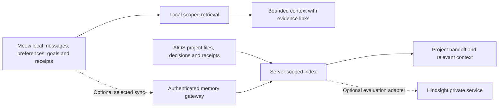

# AIOS and Meowmba long-term memory integration

Date: 2026-09-27. Updated 2026-09-28: **native implementation in progress locally**. See [implementation and limits](MEMORY_IMPLEMENTATION_STATUS.md); this is not a deployed-server or device-release claim.

## Outcome

AIOS should resume a months-long project with its current objective, decisions, unfinished work and supporting evidence intact. Meowmba should remember a user's explicitly saved preferences, people and personal projects locally, even after many newer conversations. Both should explain where a recalled fact came from and respect corrections and deletion.

Improve the existing systems first. Evaluate Hindsight as an optional server adapter after establishing a stronger baseline. Android must remain useful offline; Hindsight, TypeSafe, cloud sync and new model downloads are not prerequisites. This plan does not deploy services, migrate real data, upload history or change the Portal release.

## Verified starting point and scope

Evidence is from local source inspection, not a fresh deployed-server or installed-device audit. Android checkout: `/Users/prog/AndroidStudioProjects/Meowmba-flow-20260922`, HEAD `d2313da` at inspection. Server mirror: `agent-os/` in this Os workspace; verify against the deployed host before implementation.

| Existing component | Preserve it; address this limitation |
| --- | --- |
| Android Room memories and messages | Already has types, timestamps, importance, tags, source-message IDs and recall timestamps. Extend instead of replacing. |
| `CompanionViewModel.recallMemories` / `RecallEngine` | Automatic recall examines the latest 200 records and defaults to three results. The hash embedder measures word overlap rather than trained semantic similarity. Older data can exist but not be considered. |
| Voice reply path | One inspected `onCall` path skips memory recall. Audit all voice/text/tool reply paths; avoid improving only one chat route. |
| `MemoryScreen` | Already supports search, inspection, deletion, export, pause and retention. Extend its controls. |
| Agentic project notes | File-backed index defaults to 64 notes per project and 500 characters per note. Legacy truncation is not recoverable without another surviving source. |
| North Star goals, project workspace, saved work receipts | Already track goals, steps, evidence and distinct task outcomes. Keep these authoritative and index references to them. Do not create competing goal/progress records. |
| Server memory | SQLite records with Ollama semantic embeddings and keyword fallback; candidate search is limited to the latest 1,000 entries. |
| AIOS project artifacts | Git, navigation, handoffs, chat and task records already contain history. Retrieval must assemble that evidence and identify obsolete plans. |

Relevant source: Android `core/memory/`, `core/database/Entities.kt` and `Daos.kt`, `core/agentic/FileBackedAgenticMemory.kt`, `core/northstar/`, `core/work/ProjectWorkContext.kt`, `ui/companion/MemoryScreen.kt`; server `app.py`, `chat.py`, `studio.py`. Existing product requirements: `docs/MEOW_NORTH_STAR.md` and `docs/WORK_RESULTS_182.md` in the Android checkout.

## Architecture

Room and existing task/goal stores remain authoritative on Android. Project files, explicit decisions and execution receipts remain authoritative for AIOS. Search indexes, embeddings and summaries are derived and rebuildable. Missing or inaccessible sources are marked as such, never silently treated as verified current evidence.

Personal memory and project memory are distinct scopes. A shared interface does not mean a shared unfiltered database. The server derives owner and allowed project scope from authentication, not a client-supplied bank name. Speaker recognition is not authentication; shared-device identity remains an explicit product decision. Default personal ownership is the configured local profile.

## Memory contract

Evolve the current types with additive metadata or side tables. Final schema follows the live version audit; do not reserve a Room version or Android build number in this plan.

| Field group | Proposed meaning |
| --- | --- |
| Identity and scope | Stable record ID, owner/profile ID, optional project ID, originating device, revision and idempotency key. |
| Content and kind | Original user statement or source excerpt; existing fact/preference/episode/project types; reference to a goal or task when appropriate. |
| Evidence | Source type/ID, message/file/commit/task reference, source hash where useful, and verification method. Source links inherit access restrictions. |
| Time | Observed time, recorded time, effective interval and last validated time. Historical truth is different from current truth. |
| Status | Active, superseded, disputed, archived or deleted; relation to the replacing record. Verification separately distinguishes user-stated, tool-observed and model-inferred content. |
| Retention | Existing retention choice, optional explicit pin and sensitivity/sync policy. Embedding provider/version tracked separately. |

Corrections create a new revision and a supersedes link; conflicting ambiguous claims remain disputed. Never merge people solely because their names match. A user's report is evidence of what they reported, not independent tool verification. Existing verified/unconfirmed/handoff action states must survive indexing unchanged. An assistant promise or generated plan cannot become a completed action.

For legacy rows, preserve original IDs, timestamps, sources and data. Mark missing provenance as unknown. Do not infer confirmation merely from a high importance score. A new pin is an explicit user choice, not a silent exception to an existing deletion policy.

## Retrieval and capture behavior

1. Apply owner, project, deletion, retention and permission filters before retrieval and again before serving results.
2. Search eligible history using indexed text, explicit entity links and dates; include relevant pinned preferences and current project state. Bound candidate count, not the historical age of all candidates.
3. Fuse independent candidate lists, remove duplicates, resolve superseded facts and rank a bounded shortlist. Fetch source details only when needed.
4. Assemble a token-budgeted context packet with citations, evidence status, current objective and relevant unresolved conflicts. A larger database must not imply an ever-growing prompt.
5. Return no match when evidence is insufficient. Saved content stays quoted data and cannot grant permissions or replay actions.

Use current local search without a network dependency. Benchmark an optional compact on-device semantic embedder only after indexed retrieval works; show download size and measure memory/heat first. Keep a lightweight fallback for older phones and Portal. Voice uses a short deadline and cached relevant context; it must not acquire long cloud dependencies on the speech path.

Capture explicit remember/correct/forget commands deterministically where possible. Automatic extraction is limited to source-backed proposals under the user's memory setting, with sensitive categories excluded by default. Persist eligible task/source events and index them asynchronously. Writes and checkpoints must survive process death and retry without duplicate records. Never store hidden reasoning or credentials as memory.

## Delivery phases

### 0. Baseline, inventory and protection — first implementation milestone

- Verify live server/source revision, Android integration branch, schemas, backup formats and active reply paths. Account for concurrent work before edits.
- Count/search metadata locally; do not export personal history into a benchmark by default.
- Map existing memory, North Star, task receipts, project folders, context journal and agentic notes. Record their individual retention/truncation rules.
- Build a synthetic evaluation set with sources older than the current 200/1,000-record windows, corrections, same-name people, missing evidence and process restarts.
- Capture current retrieval accuracy, latency, prompt size, storage and model costs. Verify a restorable backup using a test copy.

Exit: reproducible baseline and migration inventory. No production behavior changes yet.

### 1. Make existing history retrievable

- Android: introduce a retrieval coordinator around the existing repository. Use whole-history indexed candidate selection, explicit scope and a bounded result budget. Include voice and all other applicable reply paths.
- Server: remove the latest-1,000 eligibility restriction through an index over the archive; preserve an indexed keyword path when embeddings are unavailable. Do not load every record and calculate every vector for each query.
- Preserve old embeddings, record their algorithm/version, and reindex incrementally. Never compare incompatible embedding dimensions or models.
- Instrument retrieval metadata without logging memory content by default.

Exit: planted old records are found after a restart; no cross-scope leakage; bounded runtime and no UI-thread indexing.

### 2. Corrections, provenance and durable personal memory

- Add versioned metadata with non-destructive Room/server migrations and tested backup compatibility.
- Extend the existing memory screen with Correct, Pin, Forget, source/evidence and optional sync status.
- Define deletion semantics clearly: ordinary chat cleanup, saved-memory deletion and “forget this everywhere” are separate actions. The last removes source-derived copies or blocks re-ingestion of the forgotten content.
- Apply corrections and deletions to indexes, caches and derived summaries; show pending remote cleanup when offline. Backups have a documented expiry/restore policy and must not silently resurrect forgotten records.
- Keep existing retention choices. Explain any proposed change to preservation before the user selects it.

Exit: corrected facts replace old current answers while historical queries still work; forgotten data cannot return through a cache, rebuild or delayed write.

### 3. AIOS continuity and Meow project integration

- Add a project checkpoint containing objective, constraints, active decisions, verified work, unresolved work, source revisions and next suggested step.
- Save on meaningful task transitions and session completion, with incremental persistence so a crash does not lose the whole session. A checkpoint never authorizes continuation by itself.
- At session start, load the current checkpoint and relevant evidence; reconcile changed commits/files and stale deployments. Distinguish implemented, tested and deployed.
- Index existing North Star and saved-work records through stable references. Preserve reported progress versus verified actions.
- Preserve raw surviving history; archive old agentic notes instead of dropping them at 64 once migration is enabled. Do not claim to recover notes already truncated.
- Add readable decision history and links in project context. Project name/folder changes must not create duplicate identities.

Exit: a fresh session can reconstruct a long project's state with citations and without rereading its entire chat history. Stop/restart never replays an interrupted external action.

### 4. Optional Hindsight evaluation on the server

- Pin a reviewed Hindsight version in an isolated test service with a separate database. Use synthetic/sample data first; reserve resources so existing inference is not displaced.
- Map approved source records to retain/recall/reflect through an adapter; use stable source IDs and verify deletion, updates and reindex behavior against the pinned version.
- Compare (A) current baseline, (B) improved native retrieval, and (C) native retrieval plus Hindsight. Keep the answer model, source corpus and context budget comparable. Separate retrieval errors from generated-answer errors.
- Run in shadow mode: it proposes context for evaluation without changing live answers or taking actions. Production adoption is a later rollout decision.
- Reflection produces attributed candidate insights, never silently confirmed facts. It must cite retained sources and pass deletion/freshness checks.
- Keep the database/admin API private behind the app's authorization layer. Memory banks alone are not access control. Self-hosting does not authorize sending personal data to an external model provider.

Adopt only for a measured gain over phase 1–3 at acceptable latency/cost. If it does not improve the target tasks, retain the native improvements and omit Hindsight.

### 5. Optional personal sync and controlled rollout

- Off by default; the user chooses server, profile and categories. Local-only memory remains the default regardless of connection state.
- Use authenticated encrypted transport, a durable outbox, revision checks and deletion tombstones. Retries are idempotent. Concurrent corrections require reconciliation; an old device cannot revive a deleted record.
- Allow revoke/disconnect/export, visibly distinguish local from synchronized content and enforce isolation on every lookup/write.
- Feature flags separate native retrieval, semantic embedding, reflection, Hindsight and sync. Roll out through test data, developer devices and an opt-in cohort.
- Keep memory work in the shared phone integration line, then carry verified compatible changes into the separate Portal branch through its build authority. Do not overwrite Portal-specific fixes or couple this to publishing Meow-Portal.

## Evaluation and acceptance

Create a fixed initial set of 60 labelled cases: 30 AIOS continuity and 30 personal-memory cases, including at least 10 paraphrases per domain. Labels name expected source IDs, scope, current/historical status and required abstention. Use separate tuning and held-out cases. Expand the set before any production-quality claim.

| Test family | Required result |
| --- | --- |
| Six-month-old decision among 10,000 newer notes | Relevant source retrieved without raising a global recent-record cap. |
| Implemented but never deployed change | State remains implemented/not deployed; no invented successful release. |
| Old preference plus a later correction | Current answer uses the correction; date-specific answer can identify the old preference. |
| Two people named Jim / two users / two projects | No unconfirmed merge or retrieval across unauthorized scopes. |
| Camera promise, followed by failed execution | Memory preserves failure/unconfirmed outcome, not a successful camera action. |
| Airplane mode, server timeout, app process death | Local memory remains available; no hanging voice turn or duplicate write. |
| Delete then retry/reindex/restore | Deleted content remains suppressed; backup restoration follows explicit deletion rules. |
| Malicious instruction inside retrieved content | Treated as source data; no permission change or action execution. |

Proposed engineering gates, to confirm against phase-0 measurements: zero isolation/deletion/false-completion failures in the fixed suite; at least 90% evidence Recall@5 on answerable held-out cases; at least 95% correct current-versus-superseded selection. Report denominators and unknowns, not just percentages. Test retrieval at 10k and 100k records. Initial local lookup target: p95 under 250 ms at 10k records on the lowest supported test device, measured separately from answer generation. Apply a voice deadline and skip optional work if it is missed. Measure background indexing heat and responsiveness.

For Hindsight, target at least a 10-percentage-point gain in grounded answer accuracy on the hard continuity subset over the improved native system, without regressing hard safety cases. Smaller gains need a clear cost/maintenance justification. Fix a cost ceiling before any paid evaluation; no paid calls are authorized by this planning document. These are proposed gates, not achieved results or vendor claims.

## Migration, rollback and first work package

Use additive migrations, preserved IDs, resumable backfills and per-record completion markers. Pause or restart indexing safely. Keep the old read path behind a flag while validating the new one. Disabling an adapter stops its requests but does not erase source data. A feature rollback is not a database downgrade: ship a forward-compatible correction rather than install an older incompatible APK. Verify encrypted backup/export restoration including new metadata and deletion state.

First work package: baseline fixtures and metrics, full-history candidate retrieval on test databases, and a short report comparing old versus new paths. Then phase 2 schema work. Do not begin by importing all personal chats into Hindsight.

## Decisions and progress

- [x] Inspect current local memory, North Star and receipt implementation.
- [x] Define phased plan and proposed evaluation gates.
- [ ] Audit live revisions, schemas, retention and backups.
- [ ] Implement and measure phase 1 on test data.
- [ ] Add correction/provenance UI and migrations.
- [ ] Connect project checkpoints and existing goal/task evidence.
- [ ] Evaluate Hindsight separately.
- [ ] Offer optional sync and staged rollout.

Defaults for now: personal memory local-only; AIOS memory project-scoped; no new mandatory model; no automatic external action; no new public Android source. Open decisions for the relevant phase: shared-device profiles, tested embedding model/size, server resource budget, paid-provider budget if wanted, sync categories and service retention period. None prevents starting the baseline work.

## Reference basis

- [Hindsight project](https://github.com/vectorize-io/hindsight): retain, recall and reflect are the optional adapter's conceptual operations.
- [Hindsight installation](https://hindsight.vectorize.io/developer/installation): its service/database deployment belongs on the server; confirm requirements against the version pinned for evaluation.
- [TypeSafe reranking cookbook](https://docs.typesafe.ai/cookbooks/rerank_typesafe): shortlist candidates before optional semantic reranking. If tested, an AI judgment can rank relevance or flag a possible contradiction; code owns identity, scope, deletion and permissions. Typed output is not proof of truth. TypeSafe is optional and server-only for this experiment; no extra dependency is planned for the local-only phone path.

These sources were consulted on 2026-09-27. External benchmark claims are not acceptance evidence for Meow or AIOS.
